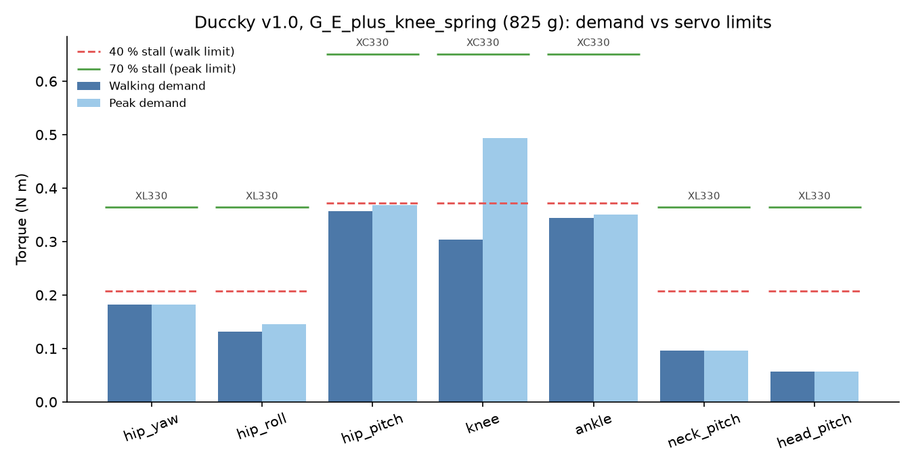
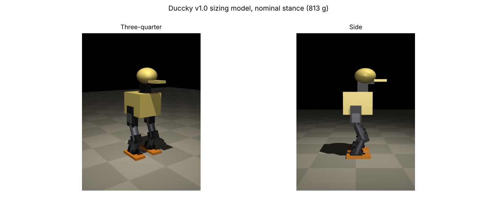

# Duccky v1.0: Actuator Sizing Study

**Document:** DCK-01 · **Revision:** C · **Phase:** 1 · **Source:** `analysis/sizing`

## 1. Result

Duccky v1.0 uses **ROBOTIS XC330-M288-T** servos at hip pitch, knee and ankle (6 units) and **ROBOTIS XL330-M288-T** servos at the other nine joints, with a **parallel assist spring at each knee (0.10 N m/rad, rest angle straight)**. This configuration passes every rule at 813 g, and again at 825 g after the Phase 2 rerun (Section 9). Both servos share the 20 × 34 × 26 mm envelope and the same TTL bus, so the leg brackets use one servo pocket design throughout.



## 2. Method

A primitive MuJoCo model is generated from `params.py`: boxes, capsules and ellipsoids carrying the Phase 0 mass budget, with each servo's mass placed at its housing. The robot stands 28.1 cm tall in nominal stance with the knee at 0.80 rad.



Five load cases build the torque demand for each joint.

| Case | Description | Basis |
|---|---|---|
| S1 | Single support. The full robot weight acts as a vertical ground reaction on one sole, with the centre of pressure (CoP) swept over the sole centre and edges. Crouch swept from 0.4 to 1.8 rad. | Gravity moments, independent of controller gains |
| S2 | Double support hip hinge, trunk pitched 0 to 80 degrees with crouched legs, the posture a get up passes through | Gravity moments |
| S3 | Neck and head pitch swept over their full ranges, head roll at its limit, beak holding a 30 g object at the tip | Gravity moments |
| D1 | Squat between 0.6 and 1.8 rad knee angle at 0.5 Hz and 1.5 Hz, full contact physics | Simulated, torque unlimited PD servos |
| D2 | Drop from 20 mm onto both feet in nominal stance | Simulated |

The leg has no ankle roll, so the robot never holds its centre of mass statically over one foot. Case S1 therefore evaluates the stance leg directly from the ground reaction, which holds for any upper body motion that produces it. The model stayed upright in every dynamic run.

Demand values used for scoring:

1. **Walking demand** is S1 at nominal stance with the CoP inside the central 60 % of the sole, multiplied by a dynamic factor of 1.5. For hip yaw it is the friction torque of a full load pivot on one foot (μ = 0.9, effective radius one third of foot length).
2. **Peak demand** is the largest value from S1 with the CoP at the sole edges, S2, S3, D1, D2, the knee swing check (spring torque at 1.60 rad fold plus shank and foot weight), and the walking demand.
3. **Joint speed** comes from a sinusoidal gait estimate at 2.5 steps per second, with joint amplitudes listed in `sizing.py`.

## 3. Pass rules

| Rule | Criterion | Reason |
|---|---|---|
| R1 | Peak demand ≤ 70 % of stall torque | Headroom for transients and model error |
| R2 | Walking demand ≤ 40 % of stall torque | Thermal margin during sustained walking |
| R3 | Walking demand ≤ torque available at half the peak gait joint speed, on a linear line from stall to no load speed | Peak stance torque and peak swing speed do not coincide |

## 4. Candidates

| Servo | Stall torque (N m) | No load speed (rpm) | Mass (g) | Envelope (mm) | Source |
|---|---|---|---|---|---|
| ROBOTIS XL330-M288-T | 0.52 at 5 V | 104 | 18 | 20 × 34 × 25 | [Generation Robots](https://www.generationrobots.com/en/403817-dynamixel-xl330-m288-t-servo-motor.html) |
| ROBOTIS XC330-M288-T | 0.93 at 5 V | 81 | 23 | 20 × 34 × 26 | [Besomi](https://besomi.com/jo_en/xc330-m288-t-dynamixel-robx0029.html) |
| Feetech STS3032 | 0.44 (4.5 kg cm) at 6 V | 111 (listed as stall speed) | 20 | conflicting figures on page | [RC Drone](https://rcdrone.top/products/feetech-scs-sts3032-4-5-kg-servo) |
| Feetech STS3215 | 1.91 (19.5 kg cm peak) at 6 V | not listed | 55 | 45 × 24.7 × 35 | [Core Electronics](https://core-electronics.com.au/feetech-sts3215-smart-servo.html.plain.md) |

The reference Microduck training repository models the XL330 as its actuator, which made it the starting point. XL330 and XC330 figures are to be confirmed against the ROBOTIS e-Manual before the BOM is frozen.

## 5. Configurations studied

Each configuration is rerun with its own servo masses, so heavier servos raise the demand they are scored against.

| Configuration | Mass (g) | Result | Failing joints (walk % / peak % of stall) |
|---|---|---|---|
| A: all XL330 | 783 | Fail | hip pitch 65 / 68, knee 78 / 106, ankle 63 / 64 |
| B: all STS3032 | 813 | Fail | hip yaw 41 / 41, hip pitch 80 / 82, knee 95 / 125, ankle 77 / 78 |
| C: STS3215 legs, XL330 elsewhere | 1005 | Fail | hip yaw 43 / 43 |
| D: all STS3215 | 1338 | Pass | none, but 57 % over the mass limit and the 45 mm servo does not fit a 28 cm robot |
| E: XC330 legs, XL330 elsewhere | 813 | Fail | knee 45 / 59 |
| F: all XC330 | 858 | Fail | hip pitch 40 / 41, knee 48 / 62 |
| **G: E plus knee assist spring** | **813** | **Pass** | none |

Two design changes were made during the study and are now in `params.py`: the nominal knee angle was reduced from 1.10 to 0.80 rad, and the shank was shortened from 58 to 50 mm (thigh 56 mm). Both shorten the horizontal lever from knee to CoP.

## 6. Selected configuration G, per joint

| Joint | Servo | Walk (N m) | Peak (N m) | Stall (N m) | Walk % | Peak % | Available at half gait speed (N m) | Gait speed (rad/s) |
|---|---|---|---|---|---|---|---|---|
| hip yaw | XL330-M288-T | 0.179 | 0.179 | 0.52 | 34 | 34 | 0.492 | 1.18 |
| hip roll | XL330-M288-T | 0.129 | 0.144 | 0.52 | 25 | 28 | 0.497 | 0.94 |
| hip pitch | XC330-M288-T | 0.352 | 0.363 | 0.93 | 38 | 39 | 0.779 | 2.75 |
| knee | XC330-M288-T | 0.297 | 0.495 | 0.93 | 32 | 53 | 0.715 | 3.93 |
| ankle | XC330-M288-T | 0.339 | 0.346 | 0.93 | 36 | 37 | 0.801 | 2.36 |
| neck pitch | XL330-M288-T | 0.096 | 0.096 | 0.52 | 18 | 18 | 0.482 | 1.57 |
| head pitch | XL330-M288-T | 0.057 | 0.057 | 0.52 | 11 | 11 | 0.464 | 2.36 |
| head yaw | XL330-M288-T | 0.008 | 0.008 | 0.52 | 2 | 2 | 0.332 | 7.85 |
| head roll | XL330-M288-T | 0.008 | 0.008 | 0.52 | 2 | 2 | 0.482 | 1.57 |
| beak | XL330-M288-T | 0.012 | 0.012 | 0.52 | 2 | 2 | 0.436 | 3.53 |

The knee peak of 0.495 N m comes from the 1.5 Hz squat (D1). Hip pitch is the joint with the least margin.

## 7. Limitations

The model uses primitive shapes and budgeted masses, so inertias are approximate until Phase 3. The dynamic factor of 1.5 and the 60 % CoP region are engineering assumptions, not measured gait data; Phase 6 replaces them with joint torque logs from trained walking policies, and the study is rerun. Gear backlash, servo friction and the real torque speed curve are not modelled here; they enter through the actuator model in Phase 5.

## 8. Reproduce

```bash
cd analysis/sizing
pip install mujoco numpy matplotlib
python compare.py                       # all configurations, tables and plot
python sizing.py --tag custom --override '{"knee": 0.023}' --set '{"LEG.knee_spring_k": 0.1}'
MUJOCO_GL=osmesa python render.py results/G_E_plus_knee_spring/duccky_sizing.xml out.png
```

## 9. Phase 2 rerun

Phase 2 replaced three inputs: the battery cartridge (105 g, was 85 g), the speaker and microphone (4 g, was 12 g), and the XL330 no-load speed from the ROBOTIS e-Manual (103 rpm, was 104). The robot now weighs 825 g. Configuration G still passes every rule, and the files in `results/` are from this run.

| Joint | Servo | Walk (N m) | Peak (N m) | Walk % | Peak % |
|---|---|---|---|---|---|
| hip yaw | XL330-M288-T | 0.182 | 0.182 | 35 | 35 |
| hip roll | XL330-M288-T | 0.131 | 0.146 | 25 | 28 |
| hip pitch | XC330-M288-T | 0.357 | 0.368 | 38.4 | 40 |
| knee | XC330-M288-T | 0.304 | 0.494 | 33 | 53 |
| ankle | XC330-M288-T | 0.344 | 0.351 | 37 | 38 |

Neck, head and beak demands are unchanged. Hip pitch remains the joint with the least margin (risk RK1).
